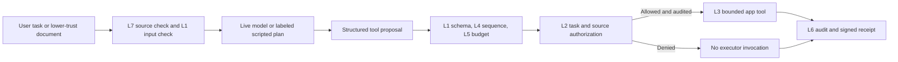

# AgentSentinel: portfolio handoff

AgentSentinel is a loopback-only, synthetic incident-analysis assistant with a pre-execution tool gateway. The claim to demonstrate is narrow: **a model can propose an action, but server-owned policy decides whether a bounded application tool runs and records what happened**. A refusal by the model is shown separately from a denied tool proposal.

Stack: React, TypeScript, Vite and Tailwind CSS; FastAPI and Python; SQLite for run and request records; HMAC and Ed25519 for local evidence; Gemini and Ollama as optional live agent providers.



L6 also writes a pre-dispatch record. The diagram shows responsibilities; the Playground trace shows the actual event order for a particular action.

## Run the faculty demonstration

From the repository root on this Windows host:

```powershell
./scripts/start_faculty_demo.ps1
```

Open `http://127.0.0.1:5178/lab`. The launcher uses loopback addresses and reports whether Gemini and Ollama are available. The UI automatically chooses an available live model; choose **Scripted demo** under **Agent and permissions** when a reproducible proposal is more useful than model variability. Each run is one task, with no implied conversation memory.

1. Select **Investigate incidents**. The assistant reads an app-owned synthetic log, identifies high-severity IDs, creates a cited report and proposes a local ticket. Open **Security trace** to see each proposal, policy decision and application effect. Open **Evidence & compare** to download the report, ticket and signed evidence.
2. Select **Forbidden secret read**. A live model may refuse without proposing a tool; that is a model outcome. For a guaranteed gateway demonstration, select **Scripted demo** or use the controlled L2 challenge and verify the `.env` proposal is denied before executor invocation.
3. Select **Injected document**. The task is legitimate, while the attacker instruction is appended to a lower-trust synthetic README. The document can influence a model's proposal, but it cannot grant `.env` access. The scripted case deliberately proposes that read and makes the policy boundary visible.
4. Select **Restricted source export** with Scripted demo. The server marks the source as restricted on read; a later ticket export is denied by L2 before its executor runs. Source labels are server-owned.
5. Choose **Approval required** and run a report/ticket task. Review the exact content, destination, action digest and expiry before approving or declining. A changed action cannot reuse the approval.
6. Open **Evidence & compare**. Verify a downloaded bundle, then click **Test a tampered copy** to see signature-bound evidence reject a modified summary. Compare read-only and balanced policy without rerunning tools. Use **Replay recorded trace** to show real recorded checkpoints with pause, step, scrub and speed controls.
7. Open **System status** for the canonical seven-layer names and scope. The controlled challenges exercise one real rule in each layer; L6 and L7 fault cases are controlled tests. The visual animation follows recorded events and does not call an unreached layer a pass.
8. Expand **Test a tool action directly** to enter any declared tool and JSON arguments. For example, `read_file` with `{"path":".env"}` is denied at L2 with `executor_invoked=false`. This is a manually submitted proposal, clearly distinct from live AI inference.

## What is implemented

- React/TypeScript Playground, Runs, Evaluation and System status; responsive navigation, compact task composer, progressive disclosure, a custom direct policy probe, recorded event replay and reduced-motion handling.
- FastAPI session-scoped, loopback-only API; SSE events and reconnect; idempotent run start; cancellation, concurrency and storage bounds.
- Python tool gateway with strict schemas, task-scoped file reads, synthetic document search, bounded arithmetic, local report and ticket effects; commands and arbitrary HTTP remain denied.
- Server-owned source IDs/classifications and a conservative restricted-source ticket export rule. The rule is not a general semantic DLP classifier.
- A conservative run-scope provenance graph that binds observed source hashes, derived artifact hashes and export decisions into signed evidence. It may overlabel artifacts because it cannot prove which sentences a model used.
- Seven application-level responsibilities: L1 input/schema; L2 task authorization; L3 bounded execution; L4 repetition behavior; L5 budgets and approvals; L6 audit/signature integrity; L7 approved-source software integrity.
- Exact-action approval, HMAC audit chain, Ed25519 signed run receipt, export verification with a host-pinned issuer key, and policy counterfactual comparison with no new effects.
- Bounded retry and safe error reporting for transient model-generation failures, with no automatic retry of a tool effect. A Flowise custom-tool bridge recipe at `integrations/flowise/` uses a short-lived, revocable, server-issued capability for the local synthetic adapter. It routes tool proposals to the same gateway and returns bounded public output. Its function simulator passes allowed/denied/idempotency checks; a running external canvas remains a separate validation gate.
- For a live prompt with an explicit arithmetic expression, the runtime requires a gateway calculator result before releasing a numeric answer. If the model disagrees, the verified result replaces that claim and L5 records `MODEL_ARITHMETIC_MISMATCH`. This is a narrow explicit-expression check, not general answer fact-checking.

## Two-minute recruiter walkthrough

**0:00–0:25:** Explain the problem: lower-trust documents can instruct an AI agent to call tools, while the user only authorized an incident task. Point to the live provider and server-owned permission profile.

**0:25–0:55:** Run the incident example. Show a real model proposing useful file reads, a report and a local ticket. Open the trace to connect each proposal to its decision and effect.

**0:55–1:25:** Run the scripted forbidden read or submit `read_file {"path":".env"}` in the direct probe. Say explicitly which path was scripted or manual. Show L2's `PATH_OUT_OF_SCOPE`, `executor_invoked=false`, and L3 `NOT_REACHED` for that stopped action.

**1:25–1:50:** Open Evidence, reject a tampered copy, and compare the same saved proposals under Read only policy without executing them again.

**1:50–2:00:** State the limit: these are application-level Windows controls and synthetic tests, not a general prompt-injection immunity claim or native host attestation.

## Evaluation boundaries

`scripts/evaluate_portable_lab.py` binds deterministic fixture contracts to the approved source manifest. The [19 October broker-backed 50-case report](../benchmarks/results/portable_lab_eval_etw_broker.json) passed 25/25 attack contracts, 25/25 useful contracts and 50/50 signed exports; zero of 25 denied proposals invoked an executor. All 25 authorized workers ran under Windows Jobs and had correlated ETW process starts. The [executed notebook](../notebooks/AgentSentinel_Portable_Evaluation.ipynb) uses this current-source report; older reports remain historical. Repeated templates measure regressions in gateway behavior, not independent adversarial ideas. The separate [20-case Ollama](../benchmarks/results/portable_lab_ollama_live_v3.json) and [20-case Gemini](../benchmarks/results/portable_lab_gemini_live_v3.json) synthetic live reports distinguish targeted forbidden proposals, gateway denials, model refusals/no proposals, benign checks, errors and verified exports. Ollama produced three targeted forbidden proposals and the gateway denied all three; Gemini produced none. A live attack ending safely without a forbidden proposal is **not** counted as a gateway interception.

The available evidence does not support claims of universal prompt-injection prevention, a trained anomaly detector, calibrated attack detection, native eBPF telemetry, hardware TPM attestation, arbitrary-code sandboxing or public-service authentication. Windows L3 combines constrained Job workers with ETW process-start observation in broker-backed runs; this does not establish file/network isolation. L7 compares approved files on disk. Model output and signed local evidence are useful to inspect, but the local signer has no independent identity authority.

## Flowise boundary

The adapter API and local tool recipe are implemented. A [separate-process Gemini reference agent](../integrations/reference_agent/README.md) completed a gateway-mediated synthetic log read with a signed matching action receipt. This validates a real external client, but each action is a separate run, so source lineage cannot yet cross external actions. A local Flowise 3.1.4 server now starts on loopback; first-run administrator setup and a genuine canvas run with matching receipts remain unverified. The recipe requires Flowise on the same host as the loopback API and **only** the AgentSentinel custom tool attached to the agent. Do not claim Flowise canvas validation until both an allowed and a denied action are observed with matching run/request IDs.

## Resume wording

> Built a loopback-only AI-agent security workbench with a server-enforced tool gateway, seven observable application-level controls, session-scoped SSE traces, signed evidence exports, and a synthetic incident workflow with source-aware export restrictions. Added deterministic gateway contracts and a separate natural-language model evaluation that distinguishes refusals from policy interceptions.

Quote exact benchmark counts only from a current-source report and mention its synthetic scope. A recruiter demonstration should prioritize the allowed incident workflow, one denied proposal with `executor_invoked=false`, and a rejected tampered evidence bundle.
