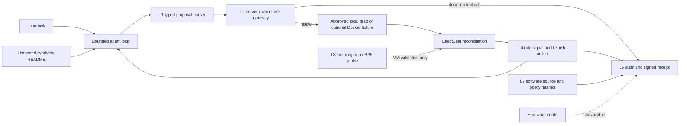

# AgentSentinel architecture and trust boundaries

Updated 2026-10-11. This diagram describes the running Gateway application. The
[completion matrix](PROJECT_COMPLETION_MATRIX.md) tracks the acceptance gate for
each of the seven proposed layers.

The task policy and audit keys are owned by the API process. README text and
tool feedback are lower-trust input to the model. The model can propose tool
calls, but the gateway decides whether an exact path or command is authorized
and records its decision before an allowed executor call. The default Compose
app uses a disposable synthetic repository and has no Docker socket.

The optional command fixture uses a pinned Linux image, a read-only root, no
network, reduced privileges and resource limits. The snapshot contains only
allowed files whose bytes match server-pinned SHA-256 digests. This prevents
changed file content from entering that fixture after the policy is built.
The fixture is a bounded demonstration, with no comprehensive container escape
assessment or arbitrary hostile-workspace support.

After each tool result, EffectSeal records whether a trusted observation can
support the allowed effects. The local Gateway has no native observer attached,
so an allowed action is `INCOMPLETE`; a denied proposal is `NOT_EXECUTED`.
The live L4 signal is deterministic gateway-derived rules. L5 can stop later
proposals on a denial or trusted observed violation. A separate research model
is inactive.

L6 chains audit records with a local HMAC and signs a final run receipt with
Ed25519. A separately pinned public key verifies an exported receipt and audit
digest offline. An optional [witness CLI](witness-anchor.md) can sign that
export under a separate key and append it to a sequence-linked ledger; no
independent witness is deployed in the running app. L7 records local software hashes; it does not attest
loaded code or a TPM/TEE. The Linux eBPF collector has been attached and tested
in a Docker Desktop VM with a controlled request cgroup, but is not connected
to the current browser request lifecycle.
