# Live workspace architecture and threat model

AgentSentinel is a local AI document assistant with an independently enforced tool
gateway. It supports uploaded UTF-8 text, Markdown and CSV, scoped search, bounded
arithmetic and downloadable reports. Gemini/Ollama perform live inference; fixture
providers remain explicitly separate in Advanced verification routes.

```mermaid
flowchart LR
  U[Local browser bearer session] --> API[FastAPI: bounded JSON and resource scope]
  API --> DB[(SQLite documents and run records)]
  DB --> S[Per-run snapshot: opaque IDs and hashes]
  S --> M[Selected live model]
  M --> V[L1 proposal schema]
  V --> B[L4 sequence rules and L5 budgets]
  B --> P[L2 authorization and exact-action approval]
  P --> I[L7 approved source recheck]
  I --> G[Durable audit and replay ledger]
  G --> W[L3 trusted worker in Windows Job]
  W --> R[Actual report and execution receipt]
  W -. optional process observation .-> E[ETW broker]
  R --> A[L6 signed evidence and independent verifier]
```

## Trust boundaries

- **Browser/API:** unguessable local bearer token, loopback-only API, explicit CORS.
  The browser never supplies owner identities or capability definitions. This is
  session isolation, not production account authentication. A stolen bearer token
  grants that session's access. Host administrator and API process are trusted.
- **Uploads:** plain UTF-8 strings, opaque server-generated IDs, no filesystem
  names from the user. SQLite BLOBs avoid user-controlled storage paths. Limits:
  16 KiB/document, 16 documents and 128 KiB/session, 8 MiB active upload data total.
  JSON is buffered up to 128 KiB before parsing (2 MB for evidence verification).
- **Snapshots:** selection is owner-checked; bytes are copied to a run directory.
  Catalog/version hashes are recorded and signed. Reads hash-check the opened
  content before releasing it. Source deletion does not remove old snapshots.
  Existing run limit is 1000; active runs are bounded to two. Host filesystem
  tampering is outside the hostile-user model; changed snapshots fail closed.
- **Model:** receives resource metadata and successful tool feedback; content is
  untrusted data. It cannot change the selected resource set or server policy.
  Gemini sends prompts/content to Google; UI discloses this. Ollama is local.
- **Tools:** schemas and default-deny policy run before dispatch. No arbitrary
  shell or outbound HTTP tool. Source references in report text must have been
  observed. This checks provenance, not semantic correctness of every sentence.
- **Execution:** trusted tool code rechecks policy. Windows workers receive only
  the authorized packet after Job assignment. They reconstruct the same catalog
  and verify its policy digest. Job Objects bound memory, process count and
  lifetime; they do not isolate an arbitrary malicious executable from the host.
- **Approvals:** exact arguments/destination, request ID/digest, 45-second expiry,
  single-use state; software baseline rechecked after the wait. Cancellation stops
  subsequent dispatch and Windows workers where supported. Completed effects are
  not rolled back.
- **Behavior:** two identical proposals maximum; live direct reads stop at the
  fifth distinct target. Counters reset per run. Scoped search is explicit and
  may inspect all selected documents. These are documented resource/sequence
  rules, not statistical anomaly detection or semantic injection detection.
- **Evidence:** durable decisions before tool dispatch, outcome records afterward,
  host HMAC chain and Ed25519 signed export. A post-execution audit fault may leave
  real effects and must never be called prevention. Independently pin the public
  key; signature validity alone does not establish a trustworthy host identity.
- **Integrity:** explicit measured source manifest, reviewed approval only. Checks
  source bytes, not loaded memory, OS compromise or hardware state. No TPM claim.

## Retention and data protection

Uploaded text, conversation content, run snapshots, generated reports and evidence
are local persistent data. They are not encrypted at rest by this change. Use
disposable/non-sensitive data for public demonstrations. Credentials stay in the
existing environment/Windows DPAPI mechanism and are not sent to the model as
document content. Payload redaction is partial and is not a complete DLP system.

Delete uploads to remove active documents; delete corresponding conversations/runs
to remove retained snapshots through existing scoped deletion. Neither operation
guarantees forensic disk erasure, removal from downloaded exports, backups, model
providers, or SQLite free pages. Losing a local session token loses normal access.

## External integrations and limits

Live workspace tickets fail closed with EXTERNAL_CONNECTOR_NOT_CONFIGURED.
No external test destination or restricted connector credential was supplied, so
no remote ticket submission is represented as implemented or verified. Local
synthetic tickets exist only in the Advanced fixture workflow. PDF/Office parsing,
production authentication, malware scanning, trained detectors and hardware
attestation are excluded from the current release scope.

Future external issue integration should use a dedicated test repository, restricted
issues-write credentials, fixed destination, exact-action approval, bounded
timeouts and conservative no-retry semantics for ambiguous write responses.
See the [official GitHub issue API](https://docs.github.com/en/rest/issues/issues#create-an-issue).
